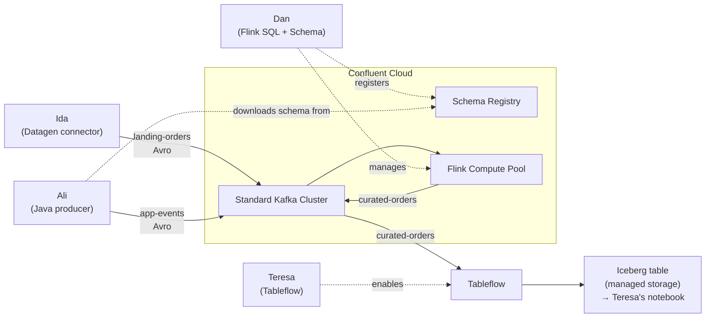

# Project Overview: Terraforming Confluent Cloud — A Talk Demo

This is a conference talk demo project that tells a story through **five personas**, each owning
their own Terraform workspace, showing how different team roles interact with a shared Confluent
Cloud data streaming platform without stepping on each other's toes.

## The Cast

| Persona | Directory | Role |
|---------|-----------|------|
| **Omar the Operator** | [`omar-the-operator/`](omar-the-operator) | Platform foundation — Confluent environment (with Advanced Governance/Stream Governance), Standard Kafka cluster, Flink compute pool in AWS `us-east-2`, plus all service accounts, API keys, and role bindings for the other three |
| **Ida the Integrator** | [`ida-the-integrator/`](ida-the-integrator) | Brings data in via a managed Datagen connector, writing sample orders as Avro into the `landing-orders` topic |
| **Ali the App Developer** | [`ali-the-app-developer/`](ali-the-app-developer) | Creates the `app-events` topic + runs a local Java/Maven producer that serialises `AppEvent` Avro messages |
| **Dan the Data Guy** | [`dan-the-data-guy/`](dan-the-data-guy) | Registers the Avro schema for Ali's events and runs a Flink SQL statement (`curate-orders.sql`) to transform the orders stream into a `curated-*` topic |
| **Teresa from the data team** | [`teresa-from-the-data-team/`](teresa-from-the-data-team) | Enables Tableflow on `curated-orders` so the data is available as an Iceberg table for reporting, in Confluent-managed storage (no bucket needed), and charts it in a local notebook (`make teresa-notebook`) |

## Architecture



## Key Design Patterns

**1. Isolated Terraform workspaces** — Each persona has their own `main.tf`, `variables.tf`,
`outputs.tf`, and local `.tfstate`. There is no shared remote state backend; hand-off happens
through environment variables instead.

**2. `.env` as the contract** — Omar's apply publishes `OMAR_*` keys, Ida's publishes `IDA_*`,
etc. A gitignored `.env` file acts as the secrets manager stand-in. The contract is documented in
[`specs/001-persona-terraform-demo/contracts/env-file-contract.md`](specs/001-persona-terraform-demo/contracts/env-file-contract.md).
`scripts/load-env.sh` fails fast if a required key is missing; `scripts/publish-env.sh` writes new
keys; `scripts/unpublish-env.sh` removes them on destroy.

**3. Topic naming convention** — `landing-*` (Ida), `app-*` (Ali), `curated-*` (Dan; Teresa's Tableflow reads `curated-orders`). Hyphens
only, no dots.

**4. Confluent Terraform provider v2.91.0** — All five workspaces use `confluentinc/confluent`.

**5. Ali's Java service** — [`ali-the-app-developer/service/`](ali-the-app-developer/service) is a
Maven project with Avro code generation. The `AppEvent` and `EventType` classes are generated from
a schema. JUnit tests cover both `EventGenerator` and `ProducerConfigLoader`.

## Developer Workflow

Apply order is Omar → Ida → Ali → Dan → Teresa (then Ali's producer), because each step depends on
resources created by the previous one.

```bash
make omar-apply   # 1. platform
make ida-apply    # 2. connector + landing topic
make ali-apply    # 3. app topic
make dan-apply    # 4. schema + Flink
make teresa-apply # 5. Tableflow turns curated-orders into an Iceberg table
make teresa-notebook # chart it in a notebook (optional)
make ali-run      # 6. start the producer (Ctrl-C to stop)
```

`make check` runs everything **offline** (Terraform fmt/validate/test + shell script tests +
JUnit) — safe to run without cloud credentials.

```bash
make demo-up    # steps 1–5 in one go
make demo-down  # tear down in reverse order, Teresa first (stop the producer first)
```

## Safety Notes

- `.env`, all `.tfstate` files, and `.terraform/` directories are **gitignored** — no secrets or
  cloud state will leak into the repo. Only `.env.example` (no values) is tracked.
- Terraform state is local to each persona directory.
- The demo creates **paid** Confluent Cloud resources (Standard cluster + Flink pool).
  Run `make demo-down` when you are done.

## Further Reading

- Full design documents: [`specs/001-persona-terraform-demo/`](specs/001-persona-terraform-demo)
- Env file contract: [`specs/001-persona-terraform-demo/contracts/env-file-contract.md`](specs/001-persona-terraform-demo/contracts/env-file-contract.md)
- Env key reference: [`.env.example`](.env.example)
